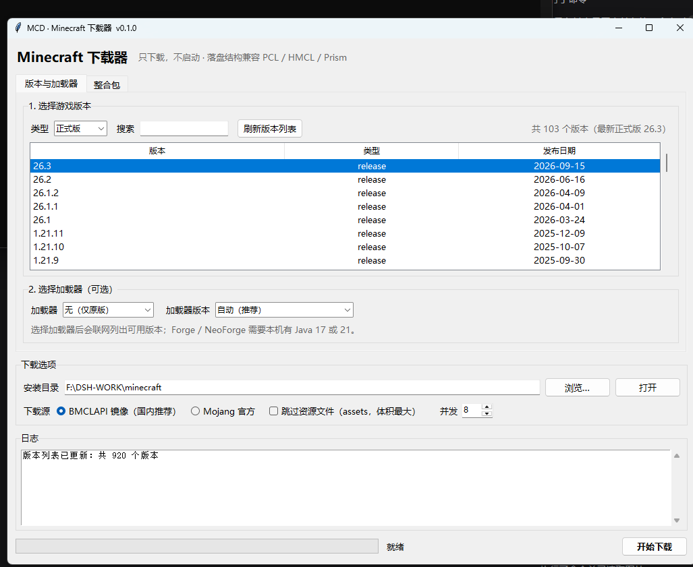

# MineCraftDownloader

独立的 Minecraft **下载器**：只负责把文件下载齐、按规范落盘，不含启动、登录、正版验证、皮肤、模组管理等任何其他功能。

起因是 PCL 在最近一次更新里禁用了“下载 Minecraft 本体”。这个项目参照 PCL 的下载源策略与目录规范，用纯 Python 标准库重新实现了一遍下载链路——不依赖 PCL、不依赖任何第三方包。

## 下载

**Windows 图形界面版（推荐）**：[Releases › v0.1.0](https://github.com/luanxing10086/mcdonloader/releases/latest) → `mcdl-gui.exe`

**命令行版**：同页面的 `mcdl.exe`

双击 `mcdl-gui.exe` 即开窗口：左边选版本、右边选加载器，底部设目录/下载源，点“开始下载”。

## 图形界面



- **版本列表**：从 Mojang / BMCLAPI 拉取，支持“正式版 / 快照 / 全部”过滤和关键字搜索，双击某行直接开始
- **加载器**：无 / Fabric / Quilt / Forge / NeoForge，选中后自动联网列出该游戏版本可用的加载器版本，默认“自动（推荐）”
- **整合包**：另一个标签页，填 Modrinth slug、页面链接或选本地 `.mrpack`
- **下载选项**：安装目录、官方源 / BMCLAPI、跳过 assets、并发数
- **日志与进度**：实时显示每个文件的下载进度，完成后可直接打开目录

界面用 tkinter（Python 标准库），不引入任何第三方依赖。

## 从源码运行 GUI

```bash
python -m mcdl.gui
```

## 能下什么

| 类型 | 说明 |
|---|---|
| 原版 | 任意正式版 / 快照，含 client jar、libraries、assets、log4j 配置、老版本 natives |
| 带加载器 | Fabric、Quilt（直装，无需 Java）、Forge、NeoForge（调官方 installer） |
| 整合包 | Modrinth `.mrpack`：本地文件、直链、项目 slug、`slug@版本` |

## 环境要求

* Python 3.8+（Windows 上建议 3.9 及以上）
* 仅 Forge / NeoForge 安装需要 Java（17 或 21，脚本会自动挑一个合适的）
* 不需要 `pip install` 任何东西

## 快速开始

```bash
# 查看帮助
python -m mcdl --help

# 环境自检：网络 + Java
python -m mcdl doctor

# 列出可下载版本
python -m mcdl list --limit 10

# 下载原版 1.20.1 到 ./minecraft
python -m mcdl install 1.20.1

# 国内网络：加 --mirror bmclapi（走 BMCLAPI 镜像）
python -m mcdl install 1.20.1 --mirror bmclapi

# 原版 + Fabric
python -m mcdl install 1.20.1 --loader fabric

# 原版 + Forge（需要 Java）
python -m mcdl install 1.20.1 --loader forge

# 原版 + NeoForge
python -m mcdl install 1.21.1 --loader neoforge --mirror bmclapi

# 整合包（Modrinth）
python -m mcdl modpack fabulously-optimized --dir ./fo --mirror bmclapi
python -m mcdl modpack fabulously-optimized --dry-run     # 只看计划，不下载

# 本地 .mrpack
python -m mcdl modpack D:\packs\MyPack.mrpack --dir ./instance
```

Windows 下也可以直接用启动器：双击或 `mcdl.cmd install 1.20.1`。

## 安装为命令

```bash
pip install -e .
mcdl install 1.20.1 --loader fabric
```

## 常用参数

| 参数 | 说明 |
|---|---|
| `--dir` | 游戏目录，默认 `./minecraft` |
| `--mirror official\|bmclapi` | 下载源，默认官方；国内建议 `bmclapi` |
| `--loader fabric\|quilt\|forge\|neoforge` | 同时安装加载器 |
| `--loader-version` | 指定加载器版本，默认最新 / Forge 推荐版 |
| `--no-assets` | 跳过 assets（体积最大，约 300–700 MB） |
| `--threads` | 并发下载数，默认 8 |
| `--proxy` | HTTP(S) 代理，如 `http://127.0.0.1:7890`；也会读 `HTTPS_PROXY` |
| `--java` | 指定 java.exe（Forge/NeoForge 用） |
| `--json` | 机器可读输出 |
| `--refresh` | 忽略 1 小时的版本清单缓存 |

## 从源码打包 exe

```bash
pip install pyinstaller
pyinstaller --onefile --console --name mcdl --paths . tools/mcdl_entry.py
```

产物在 `dist/mcdl.exe`（Windows）/ `dist/mcdl`（Linux、macOS）。约 8.6 MB，运行时自解压到临时目录。

## 落盘结构

完全遵循官方 launcher 规范，可以被任何启动器（PCL、HMCL、Prism、官方启动器）直接识别：

```
minecraft/
├─ versions/
│  ├─ 1.20.1/1.20.1.json
│  ├─ 1.20.1/1.20.1.jar
│  └─ fabric-loader-0.15.11-1.20.1/…
├─ libraries/…
├─ assets/
│  ├─ indexes/5.json
│  ├─ objects/ab/abcdef…
│  └─ log_configs/client-1.12.xml
├─ resources/…            （极老版本的 map_to_resources）
└─ .mcdl/                 （清单缓存、installer、整合包缓存）
```

## 镜像说明

`--mirror bmclapi` 时按以下规则改写（与 PCL 一致），任何一条 404 都会自动回退官方地址：

| 内容 | BMCLAPI 路径 | 是否镜像 |
|---|---|---|
| 版本清单 | `/mc/game/version_manifest_v2.json` | ✅ |
| 版本 JSON | `/version/<id>/json` | ✅ |
| 客户端 JAR | `/version/<id>/client` | ✅ |
| 资源对象 | `/assets/<xx>/<hash>` | ✅ |
| 依赖库 / 加载器 maven | `/maven/<group>/…` | ✅ |
| 资源索引 JSON | — | ❌ 回退官方 |
| log4j 配置 | — | ❌ 回退官方 |

## 已知限制

* **NeoForge 需要能访问 `maven.neoforged.net`**：installer 下载本身可以走镜像，但 installer 运行时会直连该 maven；本工具会先用 `--mirror` 预取 `install_profile.json` 里的依赖，不过 BMCLAPI 对 `net.neoforged.*` 只代理了一部分（其余返回 403）。受限网络请配 `--proxy` 或使用全局代理。
* Forge / NeoForge 的 installer 由官方提供，其内部下载不走 `--mirror`；`--mirror` 模式会先预取依赖，让 installer 尽量只做本地处理。
* Forge installer 在“Injecting profile”阶段偶尔会失败并把 `launcher_profiles.json` 截断；此时版本 JSON 与补丁后的 jar 其实已经写好，本工具会容错继续，并修复该文件。
* NeoForge 版本号会自动匹配：`1.21.1 → 21.1.x`（旧体系）、`26.3 → 26.3.x.y`（新体系）。
* 不下载 Java 运行时（只探测本机已有的）。
* 不支持 CurseForge 整合包（其 API 需要 Key）；检测到会给出明确提示。
* 不做启动，因此不生成启动参数、不合并 `inheritsFrom`——那是启动器的职责。

## 测试

```bash
python -m unittest discover -s tests -v
```

28 个用例，覆盖规则求值、镜像改写、maven 坐标、下载/校验/进度、`.mrpack` 解析与 zip-slip 防护。

真实网络冒烟测试（本机实测，`--mirror bmclapi --no-assets`）：

| 场景 | 结果 |
|---|---|
| `install 1.0` | ✅ 11 个文件 / 4.6 MB，natives 正常解压 |
| `install 1.20.1 --loader fabric` | ✅ `fabric-loader-0.20.1-1.20.1`，65 个库 |
| `install 1.20.1 --loader quilt` | ✅ `quilt-loader-0.20.0-beta.9-1.20.1`，14 个库 |
| `install 1.20.1 --loader forge` | ✅ `1.20.1-forge-47.4.10`，Java 17 跑完 installer 并产出补丁 client jar |
| `modpack fabulously-optimized` | ✅ MC 26.2 + Fabric 0.19.5，51 个文件 + 57 个 overrides |
| NeoForge 版本解析 | ✅ 1.21.1→`21.1.264`，26.3→`26.3.0.94`（新旧两套版本号都支持） |
| NeoForge 完整安装 | ❌ 本机失败：`maven.neoforged.net` 不可达，且 BMCLAPI 只代理部分 `net.neoforged` 制品（其余 403） |

打包后的 `mcdl.exe` 同样实测过：`--version`、`list`、`install 1.0`（11 文件 / 4.6 MB）全部正常。

## 目录

```
mcdl/
├─ cli.py       命令行
├─ vanilla.py   原版安装
├─ loaders.py   Fabric / Quilt / Forge / NeoForge
├─ modpack.py   .mrpack
├─ net.py       下载与进度
├─ mirror.py    镜像重写
├─ rules.py     libraries 规则
└─ java.py      Java 探测
tests/          28 个单元测试
```

## 致谢与声明

* 下载源策略、镜像路径与目录布局参考了 [PCL](https://github.com/Meloong-Git/PCL) 的实现，代码为独立编写。
* 仅下载用户有权使用的文件；请遵守 Mojang 的 EULA 与各加载器/整合包的分发许可。
* Forge 的版本 JSON 里带有“请勿自动化下载”的提示。本项目只是调用官方 installer 与官方 maven，如你认同该提示，请通过 <https://www.patreon.com/LexManos/> 支持 Forge，或手动安装。
* 发布的 `mcdl.exe` 没有商业代码签名证书，首次运行可能提示“未知发布者 / Windows 已保护你的电脑”：
  这是缺少证书的正常现象，不是文件有问题。可核对 release 里的 SHA256，或从源码运行（`python -m mcdl`）。
  想在本机消除提示，可自行生成自签名证书签名（见仓库外的 `scripts/sign-exe.ps1` 思路），
  或申请真证书 / 开源项目免费签名（SignPath）。
* 单文件 exe 启动时会把自身解压到 `%TEMP%`。若临时目录不可写（公司策略、清理工具、受限账户），
  会弹出一个标题为 “Error” 的对话框并提示 `Could not create temporary directory`。
  这时把 `TEMP`/`TMP` 指到可写目录再运行，或改用源码方式（`python -m mcdl.gui`）。
* MIT License。
